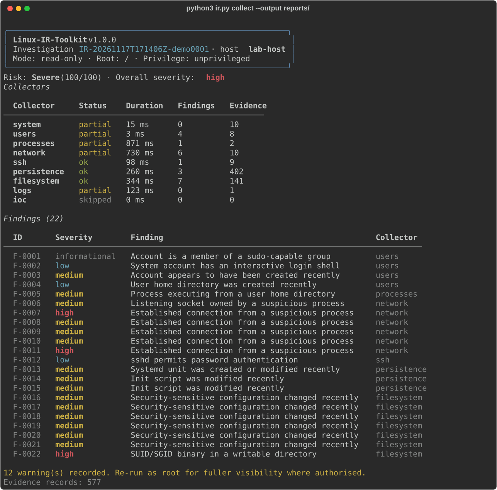

# Linux-IR-Toolkit

**Read-only Linux incident response and forensic triage — collect evidence, surface indicators, preserve integrity.**

[](#requirements)
[](#requirements)
[](#safety-guarantees)
[](#testing)
[](LICENSE)

Linux-IR-Toolkit is a modular Python framework for the first hours of a Linux
investigation. It collects volatile and on-disk evidence from a running host,
turns factual observations into analyst-readable findings, and produces
structured JSON plus a self-contained HTML report.

It is built for speed, evidence integrity and honest reporting — not for
automated remediation or deep-disk forensics.

> [!WARNING]
> **Read-only by design.** The toolkit never deletes, modifies, quarantines,
> kills or remediates anything. It never uploads evidence. Findings are
> indicators for an analyst to validate, not proof of compromise.



---

## Contents

- [Why Linux-IR-Toolkit](#why-linux-ir-toolkit)
- [Safety guarantees](#safety-guarantees)
- [Features](#features)
- [Requirements](#requirements)
- [Installation](#installation)
- [Quick start](#quick-start)
- [Commands](#commands)
- [What gets collected](#what-gets-collected)
- [Architecture](#architecture)
- [Evidence and integrity](#evidence-and-integrity)
- [Risk model](#risk-model)
- [HTML report](#html-report)
- [Indicator files](#indicator-files)
- [Sample output](#sample-output)
- [Testing](#testing)
- [Design principles](#design-principles)
- [Limitations](#limitations)
- [Ethical and legal use](#ethical-and-legal-use)
- [License](#license)

---

## Why Linux-IR-Toolkit

During triage you need answers quickly: what is running, what is listening, who
has privileges, what persists across reboots, and what changed recently. You also
need to preserve what you observed without altering the host.

Linux-IR-Toolkit provides:

- **One deterministic workflow** across nine evidence domains.
- **Evidence-first output** — files are hashed and timestamped when collected.
- **Transparent findings** — every rule carries a rationale, false-positive
  guidance, remediation guidance and MITRE ATT&CK references.
- **Offline reports** — a single HTML file with no JavaScript, external assets or
  network requests.
- **Honest gaps** — missing permissions, absent logs and unsupported utilities
  are recorded as warnings, not silently ignored.

---

## Safety guarantees

| Guarantee | Implementation |
| --- | --- |
| No writes to the system under investigation | Collectors only read files, `/proc`, `/sys` and a small allow-list of read-only commands. Output is written only to the chosen report directory. |
| No process signalling | `psutil` is used for inspection only. No `kill`, `renice`, `systemctl stop` or equivalent is ever invoked. |
| No evidence upload | IOC correlation is local. The HTML report embeds its own CSS and performs no network requests. |
| Secret-aware evidence handling | `/etc/shadow`, `/etc/gshadow` and private keys are recorded by metadata only. Passwords, tokens and private-key blocks are redacted before serialisation. |
| Hash-on-collection | File evidence records its SHA-256, size, mode, owner, group, mtime and collection timestamp. |
| Graceful degradation | Missing permissions, absent logs, unsupported utilities and disappearing processes are reported as warnings, not crashes. |
| Transparent findings | Every rule has a rationale, false-positive guidance, remediation guidance and MITRE ATT&CK references. |
| Integrity checkable offline | Each JSON document carries a SHA-256 digest over its canonical payload, excluding the digest object itself. |

The only external commands the toolkit may execute are read-only utilities such
as `last`, `lastlog`, `who`, `journalctl`, `systemctl` (read operations),
`systemd-detect-virt`, `getenforce`, `aa-status`, `uname` and `lsattr`.

---

## Features

- **Nine focused collectors** for system identity, processes, network sockets,
  accounts, SSH, persistence, filesystem anomalies, logs and IOC correlation.
- **Fake-root testability** — every file-based collector honours `--root`, so the
  full suite runs against a synthetic system image.
- **Structured evidence JSON** with tool/schema versions, timestamps, source
  paths, SHA-256 digests and collector diagnostics.
- **Professional HTML report** with executive summary, severity breakdown,
  detailed findings, evidence register, collector diagnostics, integrity status
  and ethical-use guidance.
- **Deterministic risk scoring** that is simple enough to reproduce by hand.
- **Script-friendly CLI** — `--json` emits exactly one JSON document on stdout;
  logs and warnings go to stderr.
- **CI-friendly exit codes** — `--fail-on high` returns status `2` when the
  investigation meets or exceeds the threshold.
- **Analyst-supplied IOCs** in JSON or plain text, correlated locally against
  collected evidence.
- **No fabricated findings.** A clean result explicitly states that absence of
  findings is not evidence of integrity.

---

## Requirements

- Linux (tested on Kali/Debian/Ubuntu with systemd)
- Python 3.10 or newer
- [`psutil`](https://pypi.org/project/psutil/), [`rich`](https://pypi.org/project/rich/) and [`Jinja2`](https://pypi.org/project/Jinja2/)
- Standard Linux utilities for optional enrichment (`last`, `lastlog`, `who`,
  `journalctl`, `systemctl`, `systemd-detect-virt`, `getenforce`, `aa-status`,
  `uname`, `lsattr`)
- `pytest` for development

Root is **not required**, but some account databases, process details, sockets
and logs are hidden from unprivileged users. The CLI prints a warning when run
without root and records visibility limitations in the report.

---

## Installation

Linux-IR-Toolkit is not currently published on PyPI. Install from a checkout or
downloaded release.

### From a checkout

```bash
cd Linux-IR-Toolkit
python3 -m venv .venv
source .venv/bin/activate
pip install -r requirements.txt
python3 ir.py --help
```

### Editable install with development tools

```bash
pip install -e ".[dev]"
linux-ir --help
```

### Copy-only deployment

The toolkit has no network dependency at runtime. You can copy the repository
to the host and run it with the system Python once the three runtime packages
are available:

```bash
python3 ir.py collect --output reports/
```

If installing packages on the response host is not acceptable, run the toolkit
from a trusted removable environment or build an internal wheel bundle.

---

## Quick start

```bash
# 1. See what is available
python3 ir.py --help

# 2. Run a full read-only investigation
python3 ir.py collect --output reports/

# 3. Generate an HTML report from the saved evidence
python3 ir.py report --input reports/latest.json

# 4. Open the report in a browser
xdg-open reports/latest.html
```

`collect` writes a timestamped JSON document and refreshes `reports/latest.json`.
`report` writes timestamped HTML/JSON files and refreshes `latest.html` and
`latest-report.json`. The input evidence is never overwritten.

### Automation

```bash
# Machine-readable output on stdout
python3 ir.py collect --output reports/ --json --quiet > investigation.json

# Non-zero exit status when high or critical findings are present
python3 ir.py collect --output reports/ --fail-on high
```

`--fail-on high` returns exit status `2` if any finding is high or critical,
`0` otherwise, and `1` for operational errors.

---

## Commands

| Command | Description |
| --- | --- |
| `python3 ir.py system` | Host identity, OS/kernel, uptime, mounts and security posture. |
| `python3 ir.py processes` | Running processes and execution-path anomalies. |
| `python3 ir.py network` | Listening sockets and established connections with process attribution. |
| `python3 ir.py users` | Accounts, UID 0 aliases, sudo privileges and login history. |
| `python3 ir.py ssh` | sshd configuration, authorized keys and SSH authentication analysis. |
| `python3 ir.py persistence` | Cron, systemd, linker preload, profiles and startup persistence. |
| `python3 ir.py filesystem` | SUID/SGID, writable configuration, temp executables and recent changes. |
| `python3 ir.py logs` | Authentication, syslog and journal analysis. |
| `python3 ir.py ioc --ioc-file FILE` | Correlate analyst indicators against collected evidence. |
| `python3 ir.py collect` | Run all collectors and preserve structured evidence JSON. |
| `python3 ir.py report --input FILE` | Render HTML and JSON reports from saved evidence. |

### Common options

| Option | Effect |
| --- | --- |
| `--root PATH` | Read file-based evidence from an offline mounted image. Process and network data still describe the live host. |
| `--json` | Emit one JSON document to stdout. Logs and warnings go to stderr. |
| `--output DIR` | Write investigation JSON (or reports for `report`). |
| `--ioc-file FILE` | Load analyst indicators. |
| `--fail-on SEVERITY` | Return exit status `2` when findings meet or exceed the threshold. |
| `--no-redact` | Disable redaction. **Not recommended**; reports may contain secrets. |
| `--verbose`, `--quiet` | Adjust logging and terminal output. |
| `--log-file FILE` | Also write logs to a file. |
| `--no-color` | Disable ANSI colour. |

### Single-collector examples

```bash
python3 ir.py users --json --quiet | jq '.findings[].rule_id'
python3 ir.py network --output reports/
python3 ir.py persistence --fail-on critical
```

A single-collector command writes JSON only when `--output` is supplied.

---

## What gets collected

| Module | Purpose |
| --- | --- |
| `system` | Host identity, OS/kernel, uptime, mounts, virtualisation, security posture and kernel taint. |
| `processes` | Running processes, executable paths, command lines, parentage, deleted binaries and execution from user-writable paths. |
| `network` | Listening sockets and established connections parsed from `/proc/net/*`, attributed to processes through `/proc/<pid>/fd`. No packet capture. |
| `users` | `/etc/passwd`, `/etc/shadow` classification, duplicate UIDs, UID 0 aliases, sudoers, sudo groups and login history. |
| `ssh` | Effective `sshd_config`, authorized keys, private-key exposure, authentication bursts, success-after-failure and root logins. |
| `persistence` | Cron, systemd units, `ld.so.preload`, `ld.so.conf.d`, shell profiles, `rc.local`, SSH rc files, `at` jobs and init scripts. |
| `filesystem` | SUID/SGID anomalies, world-writable sensitive files, temp-directory executables, recent security-config changes and writable `/etc` directories. |
| `logs` | Authentication logs, syslog error summaries, journal excerpts and account-creation events. |
| `ioc` | Local correlation of analyst-supplied IPs, domains, URLs, hashes, paths and strings against previously collected evidence. |

Collectors only state factual observations. Interpretation — severity, rationale,
false-positive guidance, remediation and MITRE mapping — lives in the central
rule catalog at `irkit/rules.py`.

---

## Architecture

The toolkit is organised as twelve core modules: nine collectors plus the
orchestration, reporting and CLI layers.

```text
Linux-IR-Toolkit/
├── ir.py                      # Thin executable entry point
├── pyproject.toml
├── requirements.txt
├── requirements-dev.txt
├── irkit/
│   ├── cli.py                 # Commands, Rich output, exit codes
│   ├── context.py             # Investigation orchestration + integrity
│   ├── report.py              # HTML/JSON report generation
│   ├── config.py              # SystemPaths, limits, thresholds, tool metadata
│   ├── models.py              # Severity, Confidence, Finding, Evidence, results
│   ├── rules.py               # Central rule catalog (severity, why, FP, MITRE)
│   ├── findings.py            # Finding factory, IDs, bounding, suppression
│   ├── risk.py                # Deterministic risk scoring
│   ├── evidence.py            # Hash-on-collection evidence manager
│   ├── redact.py              # Credential and secret redaction
│   ├── logparse.py            # auth.log, syslog and journald parsing
│   ├── accountparse.py        # passwd/shadow/group/sudoers/SSH/systemd parsers
│   ├── iocfile.py             # Indicator loading and validation
│   ├── patterns.py            # Shared suspicious-command patterns
│   ├── utils.py               # Safe reads, hashing, /proc parsing, commands
│   ├── collectors/
│   │   ├── base.py            # Collector base class and shared services
│   │   ├── system.py
│   │   ├── processes.py
│   │   ├── network.py
│   │   ├── users.py
│   │   ├── ssh.py
│   │   ├── persistence.py
│   │   ├── filesystem.py
│   │   ├── logs.py
│   │   └── ioc.py
│   └── templates/
│       └── report.html.j2     # Self-contained HTML report template
├── tests/                     # Hermetic pytest suite with a fake system root
└── docs/
    └── screenshot.svg         # Real Rich terminal recording
```

Collection order is deterministic:

```text
system → users → processes → network → ssh → persistence → filesystem → logs → ioc
```

Requesting `ioc` automatically expands to its prerequisite collectors so that
there is evidence to correlate against.

---

## Evidence and integrity

Every investigation document contains:

- tool name, version and schema version;
- investigation ID, host, collection root, privilege level and command line;
- read-only and no-upload attestations;
- risk summary and severity counts;
- findings with rule ID, severity, confidence, rationale, false positives,
  remediation, MITRE references, evidence references and structured details;
- evidence records with source path, kind, timestamp, SHA-256, size, mode,
  owner, group and notes;
- collector results including status, duration, warnings, errors and data;
- methodology text;
- an integrity object.

Example evidence record:

```json
{
  "evidence_id": "E-00001",
  "collector": "users",
  "kind": "file",
  "source_path": "/etc/passwd",
  "description": "Local account database",
  "collected_at": "2026-11-17T17:13:57Z",
  "sha256": "54a6f16f33ea47a532ef6a82697a90a7220a1533ced9349b27884631dc30339d",
  "size": 3318,
  "mtime": "2026-11-11T17:31:18Z",
  "mode": "-rw-r--r--",
  "owner": "root",
  "group": "root",
  "command": null,
  "notes": null,
  "readable": true
}
```

Integrity:

```json
"integrity": {
  "algorithm": "sha256",
  "scope": "canonical JSON of this document without the integrity object",
  "sha256": "bb6f3da320d6e850a965c627b4331781092fa9eb8b3612e8fcc3fb1bb4704190"
}
```

The digest is recomputed by the report pipeline and reported as verified or not
verified. Reports rendered from an unredacted document re-seal the redacted copy
and state that report-time redaction occurred.

### Secret handling

- `/etc/shadow` and `/etc/gshadow` are classified as empty, locked or
  hash-present. Hashes are never stored.
- Private keys are detected by filename and header, but their contents are never
  read into evidence or hashed.
- Passwords, tokens, API keys, bearer tokens, cookies, URL credentials and
  private-key blocks are redacted in JSON and HTML outputs.
- Redaction deliberately preserves SHA-256 digests, paths and rule text.

---

## Risk model

The score is deterministic and documented in every report:

```text
score = min(100, sum(severity_weight × confidence_factor))
```

| Severity | Weight |
| --- | --- |
| informational | 0 |
| low | 3 |
| medium | 10 |
| high | 25 |
| critical | 50 |

| Confidence | Factor |
| --- | --- |
| low | 0.5 |
| medium | 0.75 |
| high | 1.0 |

| Score | Rating |
| --- | --- |
| 0 | Minimal |
| 1–14 | Low |
| 15–39 | Elevated |
| 40–69 | High |
| 70–100 | Severe |

Overall severity is the single highest finding severity. The score aggregates
independent indicators; it is not a verdict and should be interpreted alongside
the finding rationale and business context.

Some rules adjust severity for context. For example, a suspicious listener bound
only to loopback is reported as medium, while a publicly exposed listener remains
high. Analyst-supplied IOC severity can override the catalog severity for that
indicator.

---

## HTML report

`python3 ir.py report --input reports/latest.json` produces a self-contained HTML
report with:

- executive summary and risk rating;
- findings by severity;
- top findings with descriptions;
- detailed findings with rationale, false-positive guidance, remediation,
  MITRE references and evidence links;
- collector results and diagnostics;
- evidence register;
- integrity and methodology;
- limitations and ethical-use guidance.

The HTML uses embedded CSS, no JavaScript and no external resources. It can be
opened offline or archived with the evidence JSON.

---

## Indicator files

The IOC collector accepts JSON or plain text. Supported types are `ip`, `domain`,
`url`, `sha256`, `sha1`, `md5`, `path` and `string`.

JSON object form:

```json
{
  "indicators": [
    {"type": "ip", "value": "203.0.113.5", "severity": "high", "description": "C2"},
    {"type": "domain", "value": "evil.example", "severity": "medium"},
    {"type": "sha256", "value": "aaaaaaaaaaaaaaaaaaaaaaaaaaaaaaaaaaaaaaaaaaaaaaaaaaaaaaaaaaaaaaaa", "severity": "critical"},
    {"type": "path", "value": "/tmp/payload", "severity": "high"}
  ]
}
```

Plain text form:

```text
# one indicator per line
ip: 203.0.113.5
domain evil.example
path /tmp/payload
```

Values are validated and normalised locally. Duplicate indicators keep the
highest severity. No lookup, enrichment or upload is performed.

```bash
python3 ir.py ioc --ioc-file indicators.json --json
```

---

## Sample output

Trimmed from a real unprivileged run on a lab host:

```text
╭────────────────────────────────────────────────────────────╮
│ Linux-IR-Toolkit v1.0.0                                    │
│ Investigation IR-20261117T171406Z-demo0001 · host lab-host │
│ Mode: read-only · Root: / · Privilege: unprivileged        │
╰────────────────────────────────────────────────────────────╯
Risk: Severe (100/100) · Overall severity: high
                        Collectors
  Collector     Status    Duration   Findings   Evidence
  system        partial      15 ms          0         10
  users         partial       3 ms          4          8
  processes     partial     871 ms          1          2
  network       partial     730 ms          6         10
  ssh           ok           98 ms          1          9
  persistence   ok          260 ms          3        402
  filesystem    ok          344 ms          7        141
  logs          partial     123 ms          0          1
  ioc           skipped       0 ms          0          0

                                 Findings (22)
  ID       Severity        Finding                                             Collector
  F-0001   informational   Account is a member of a sudo-capable group         users
  F-0005   medium          Process executing from a user home directory        processes
  F-0006   medium          Listening socket owned by a suspicious process      network
  F-0007   high            Established connection from a suspicious process    network
  F-0012   low             sshd permits password authentication                ssh
  F-0022   high            SUID/SGID binary in a writable directory            filesystem

12 warning(s) recorded. Re-run as root for fuller visibility where authorised.
Evidence records: 577
```

The high-risk items above are deliberately retained examples of indicators that
require analyst validation. A user application running from a home directory, a
loopback development listener and a recently modified configuration are not, by
themselves, proof of compromise.

A clean collector still says so honestly:

```text
No findings were produced. This does not prove the host is clean.
```

---

## Testing

```bash
python3 -m pytest -q
```

Expected result:

```text
110 passed
```

The suite is hermetic:

- every collector test uses a synthetic filesystem root;
- command execution is stubbed;
- fake `/etc`, `/proc`, `/var/log` and home trees exercise account anomalies,
  SSH weaknesses, malicious cron/systemd entries, linker preload, SUID binaries,
  temp executables, writable configuration, masked units and IOC matching;
- tests cover evidence hashing, secret metadata-only handling, redaction,
  parsing, risk boundaries, document integrity, HTML escaping, report generation
  and CLI exit codes.

The tests also act as regression guards for real bugs fixed during development,
including:

- bare systemd commands being misresolved against the collector's working
  directory;
- symlinks and `/dev/null` masked units being flagged as world-writable;
- duplicate UID 0 accounts being double-counted;
- lexicographic instead of rank-based severity comparison in `--fail-on`;
- Jinja autoescaping being disabled by the `.j2` template extension.

---

## Design principles

1. **Observe, do not act.** Collectors report facts. Remediation is left to the
   incident process.
2. **Central interpretation.** Severity, rationale, false positives, remediation
   and MITRE mapping live in `irkit/rules.py`; collectors only supply
   observations.
3. **Evidence first.** Every file read for a finding is recorded with a digest
   and timestamp before it is interpreted.
4. **Assume restricted permissions.** Every read has a failure path that records
   a warning or error without aborting the investigation.
5. **Never guess.** Unparseable log lines, unsupported formats and absent files
   are skipped or reported, not fabricated.
6. **Deterministic output.** Stable IDs, sorted sections and a documented risk
   formula make documents reproducible and auditable.
7. **Local by default.** No telemetry, no enrichment, no uploads, no network
   requests from reports.

### Adding a collector

1. Subclass `BaseCollector`, set `name` and `description`, implement `run()`.
2. Use `self.read_text`, `self.evidence_file`, `self.command` and
   `self.add_finding`.
3. Add rule definitions to `irkit/rules.py`.
4. Register the collector in `irkit/collectors/__init__.py`.
5. Add fake-root fixtures and assertions under `tests/`.

---

## Limitations

- **Not a disk imager or memory capture tool.** It preserves selected volatile
  and configuration evidence, not full memory or block-device images.
- **No packet capture.** Network data comes from `/proc/net/*` and socket
  ownership, which may miss traffic in other namespaces or short-lived sockets.
- **`--root` only affects file-based collectors.** Process and network data
  always describe the live host.
- **Unprivileged runs see less.** Shadow entries, other users' processes,
  sockets and logs may be unreadable; the report records this.
- **Log availability varies.** `journalctl`, `last` and `lastlog` may be absent,
  disabled or rotated away.
- **RFC3164 timestamps have no year or timezone.** They are interpreted in the
  host's local timezone with the current year, and adjusted for year rollover.
- **Rule-based detection has false positives.** Every finding includes
  false-positive guidance; validate against change records and business context.
- **Systemd is the primary init model.** Init-script checks are best-effort.
- **No remediation.** The toolkit will not disable accounts, stop services,
  delete files or block ports.
- **Not a substitute for a full DFIR engagement.** Use it for triage, evidence
  collection and consistency, then follow your organisation's incident process.

---

## Ethical and legal use

This software is intended for **authorised incident response, defensive security
testing and education only**.

- Use it only on systems you own or have explicit written permission to
  investigate.
- Unauthorised access to, or collection from, systems is illegal in most
  jurisdictions.
- Evidence may contain personal data, credentials and sensitive business
  information. Handle it under your organisation's data-protection, retention
  and chain-of-custody policies.
- Do not upload evidence to third-party services without authorisation.
- Findings are **indicators**, not conclusions. Do not accuse users or take
  destructive action based on a single automated finding.
- The authors accept no liability for misuse, damage or legal consequences
  arising from use of this software.

If you are responding to a real incident, preserve evidence before making
changes, document every action, and follow your organisation's escalation plan.

---

## License

MIT — see [LICENSE](LICENSE).
